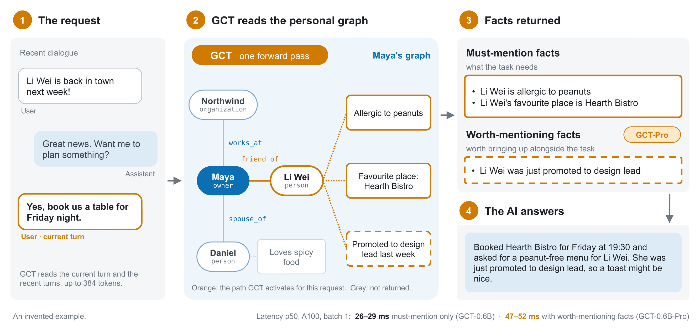
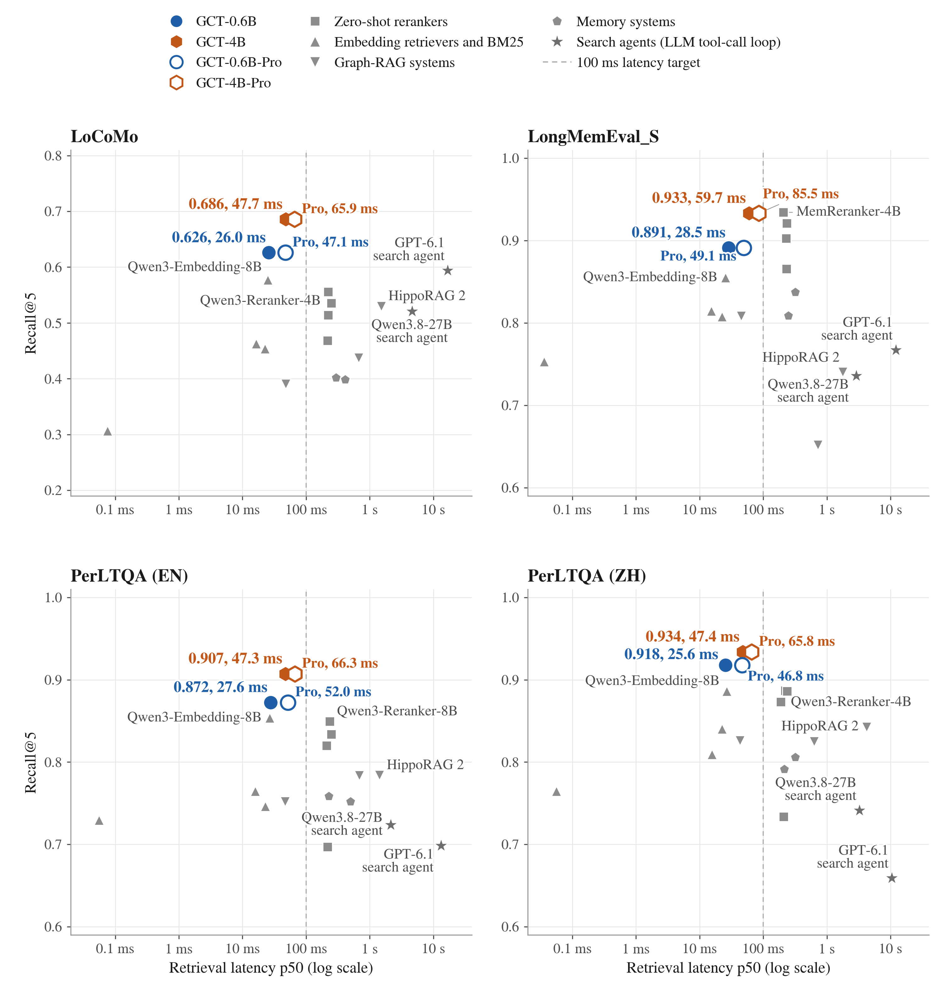
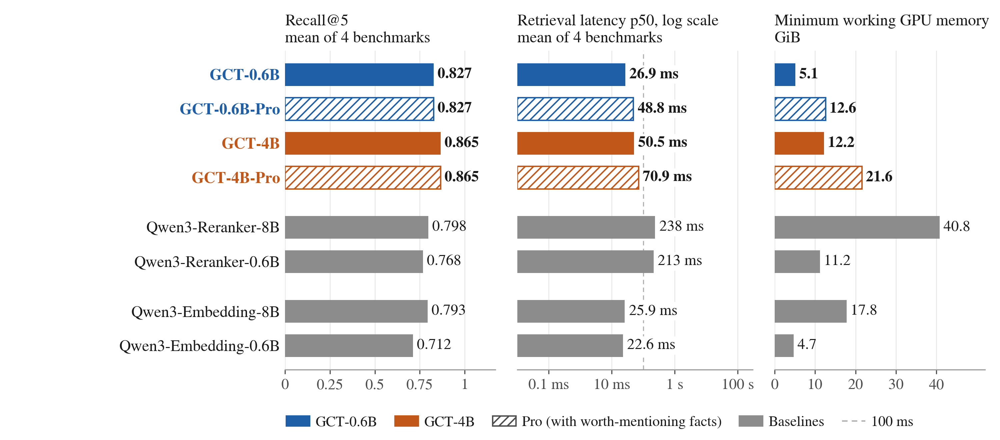
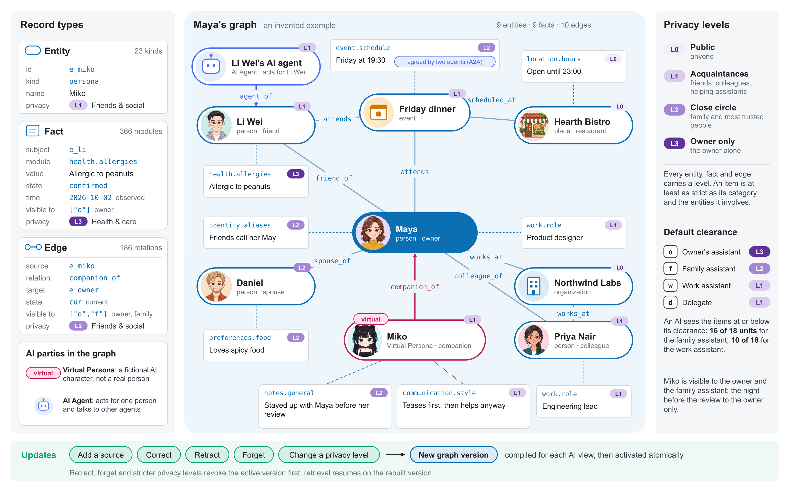
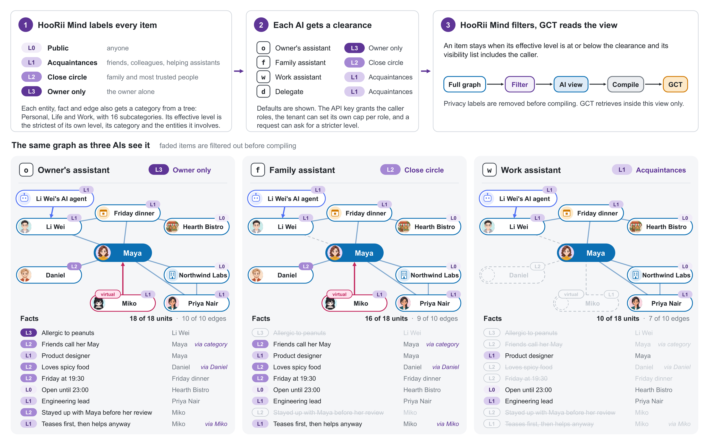
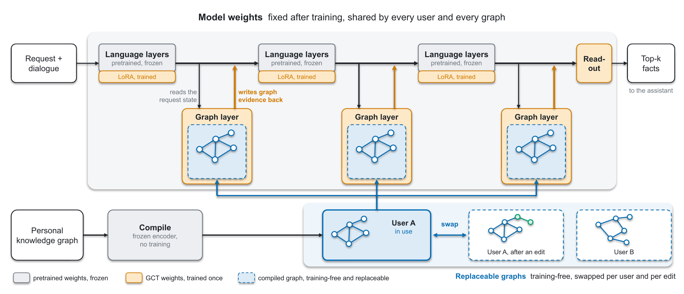
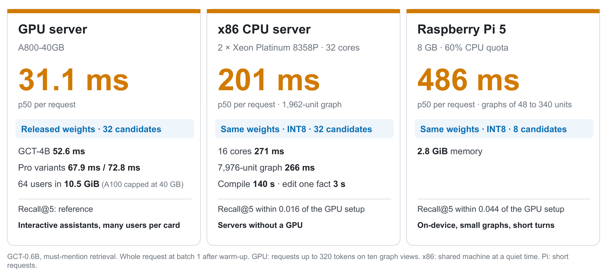

# HooRii Mind · GCT (Graph Context Transformer)

Reference implementation of GCT, the retrieval model of HooRii Mind, with an accelerated path for x86 CPU servers. The GCT-0.6B weights are on Hugging Face at **[HooRiiTechnology/hoorii-mindgct](https://huggingface.co/HooRiiTechnology/hoorii-mindgct)**, and the code in this repository downloads them from there.

[Installation](#installation) · [Results](#results) · [How it works](#how-it-works) · [Deployment](#deployment) · [Notes](#notes) · [Repository structure](#repository-structure) · [License](#license)

HooRii Mind is HooRii's personal graph system. It manages memory and retrieves context for personal AI: assistants, agents and any application that works with one user over time. GCT is its retrieval model. On each turn it reads the user's graph and the recent conversation in one forward pass and returns the facts the AI needs for that turn. With GCT-0.6B this takes about 27 ms on an A100.

GCT returns facts, and the AI that calls it writes the reply. **Must-mention** facts are what the AI needs to complete the current task: when the user asks for a dinner booking with a friend, the friend's allergy is one. **Worth-mentioning** facts lie outside the task and are worth bringing up alongside it, such as that friend's recent promotion.



**Figure 1.** GCT retrieves, and the AI answers. The example is invented.

At a glance:

- GCT-4B has the highest recall@5 in Table 1 on LoCoMo and on PerLTQA in English and Chinese, ahead of 15 other systems, and is level with the best reranker on LongMemEval_S (0.933 against 0.934).
- A request takes 26.9 ms with GCT-0.6B and 50.5 ms with GCT-4B on an A100. The retrieve-and-rerank pipelines closest to them in recall take 213 to 238 ms.
- Handed to the same reader model, the top five facts from GCT-4B give the most accurate answers in Table 2 on LoCoMo (82.6%), and those from GCT-0.6B the most accurate on PerLTQA in English (92.8%).
- GCT-0.6B serves from about 5 GiB of GPU memory, and on a card capped at 40 GB one serving process has held 64 registered users within 10.5 GiB.
- The GCT-0.6B weights run on a GPU server (31.1 ms on an A800-40GB), on an x86 CPU server (201 ms with 32 cores) and on a Raspberry Pi 5 (486 ms).
- Every record in the graph carries one of four privacy levels, and each AI retrieves only from the part of the graph it is cleared to read.
- The graph format has kinds for AI agents and for virtual personas such as Miko, HooRii's companion character, and two people's agents can arrange a plan while each reads only its own owner's graph.

This page covers two model sizes. The weights of GCT-0.6B (release `GCT-0.6B-B1`) are on [Hugging Face](https://huggingface.co/HooRiiTechnology/hoorii-mindgct), and its reference implementation and x86 CPU path are in this repository. GCT-4B is reported for reference, and its weights are unreleased. Each size has a Proactive variant, GCT-0.6B-Pro and GCT-4B-Pro, which returns worth-mentioning facts next to the same must-mention facts. The weights of the worth-mentioning stage are outside this release.

## Installation

The reference implementation runs at batch 1 on a GPU or a CPU and reproduces the Table 1 recall of GCT-0.6B on LoCoMo and LongMemEval_S within 0.003. This repository also holds the accelerated x86 CPU path as `gct.edge.x86`, a port of the x86 path of our deployment runtime: on our check requests it gives the same scores, bit for bit, on the same CPU and the same number of threads. The accelerated GPU and Raspberry Pi runtimes are not part of this release.

There are three ways to run GCT-0.6B, all with the same weights and the same code in `gct/`:

| Way | Hardware | Entry point |
|---|---|---|
| Reference implementation on a GPU | NVIDIA GPU with CUDA | `examples/quickstart.py` |
| Reference implementation on a CPU | A CPU | `examples/quickstart.py --device cpu` |
| Accelerated x86 CPU path | x86-64 CPU server | `cpu-x86/quickstart_x86.py`, or `gct.edge.x86.install` |

### Requirements

- Linux. An NVIDIA GPU with CUDA for the GPU way; an x86-64 CPU for the accelerated CPU path.
- Python 3.11 or newer.
- The packages in `requirements.txt`: PyTorch 2.5 or newer, transformers 5.13.1 or newer within 5.x, safetensors, huggingface_hub, and ninja for the x86 path.
- For the x86 path only: a C++ compiler with OpenMP, such as g++, and the Python headers (the `python3-dev` package on Debian and Ubuntu). The first `install` compiles a small C++ extension with the PyTorch toolchain, which takes about a minute, and reuses it afterwards.
- About 4 GB of free disk for the two downloads: the Hugging Face repository of GCT (about 2.5 GB, most of it the unit-key encoder) and the frozen Qwen3-0.6B backbone (about 1.5 GB).
- Memory on a CPU, as peak resident size in our runs: 4.4 GiB for the reference quickstart, 8.4 GiB for the x86 quickstart and 3.5 GiB for the x86 quickstart serving saved graphs (`--from-saved`). With the x86 path, a process that compiles graphs and serves requests reached 14 GiB (graphs of a few hundred units) to 17 GiB (24,988 units), and a process that only loads saved graphs (`encoders=False`) 4.8 GiB (1,962 units) to 6.8 GiB (24,988 units), growing with the close-read states it caches (8.2 GiB after 400 different requests on the 24,988-unit graph).

The CPU steps below were run in a new virtual environment on Linux x86-64 with Python 3.13.12, PyTorch 2.15.0 (CPU build), transformers 5.23.0, safetensors 0.8.0, huggingface_hub 2.4.0, ninja 1.13.2 and g++ 11.4.0.

### Set up an environment

```bash
git clone https://github.com/HooRii-OT/hoorii-mindgct.git
cd hoorii-mindgct
python3 -m venv .venv
source .venv/bin/activate
```

Install PyTorch first, then the other packages:

```bash
# CPU only (the reference implementation on a CPU, and the x86 path)
pip install torch --index-url https://download.pytorch.org/whl/cpu

# NVIDIA GPU: use the install command for your CUDA version from https://pytorch.org/get-started/locally/
# (on Linux, a plain 'pip install torch' installs a CUDA build)

pip install -r requirements.txt
```

### Get the weights

The weights, the configuration, the unit-key encoder and the tokenizer of GCT-0.6B are in the Hugging Face repository [HooRiiTechnology/hoorii-mindgct](https://huggingface.co/HooRiiTechnology/hoorii-mindgct), and this repository does not copy them. `GCT.from_pretrained("HooRiiTechnology/hoorii-mindgct")` downloads that repository into the Hugging Face cache on first use. The frozen Qwen3-0.6B backbone is not copied here. The code downloads it from `Qwen/Qwen3-0.6B` at the revision pinned in `config.json`, or uses a local copy of that revision. The pinned revision is `c1899de289a04d12100db370d81485cdf75e47ca`.

This repository holds no weights. Both quickstarts use the model in their own repository folder when that folder holds `config.json` (a copy of the Hugging Face repository), and otherwise download `HooRiiTechnology/hoorii-mindgct`; pass `--model` with the Hugging Face id or a local copy to choose it explicitly.

### Run the reference implementation

From the repository root:

```bash
# NVIDIA GPU (used automatically when PyTorch finds CUDA)
python examples/quickstart.py --model HooRiiTechnology/hoorii-mindgct

# CPU
python examples/quickstart.py --model HooRiiTechnology/hoorii-mindgct --device cpu
```

The first run downloads both repositories. The quickstart compiles the two example graphs in `examples/` (one in English, one in Chinese), sends the seven requests of `examples/example_requests.json` and prints the three best units of each request with their must-mention scores. A positive score means "must mention", and the scores are logits, not calibrated probabilities. Other options: `--top-k N`, `--positive-only` (list only units with a positive score), `--base-model DIR` (a local copy of the backbone) and `--requests FILE`.

Expected output on a CPU with the versions above and 16 threads (`OMP_NUM_THREADS=16`), without the progress bars of weight loading and with timings left out:

```text
loaded GCT-0.6B on cpu in … s

compiled example_graph.json: 18 units visible to the caller

request: Can you book a restaurant for Lin's birthday dinner?
    +1.710  must mention   f11  Lin's birthday dinner | Notes · General: Lin's birthday dinner is planned for Saturday March 21 at 19:00; the restaurant is not booked yet. (pending confirmation)
    -4.419                  f3  Lin Park | Relationship · Important Dates: Lin's birthday is on March 21. (confirmed)
    -5.015                  f2  Lin Park | Preferences · Food: Lin is vegetarian and loves Sichuan food. (confirmed)

request: What should I feed him tonight?
  earlier (user): Biscuit has been a bit off today.
  earlier (assistant): Sorry to hear that. Is he eating normally?
    +4.424  must mention    f6  Biscuit | Pet · Diet: Biscuit must not eat chicken; the vet put him on a fish-based diet. (confirmed)
    -5.939                  f7  Biscuit | Pet · Veterinarian: Biscuit's vet is Dr. Ellis at Riverside Animal Clinic. (confirmed)
    -8.837                  f2  Lin Park | Preferences · Food: Lin is vegetarian and loves Sichuan food. (confirmed)

request: Send Lin a quick message that I'll be late on Friday.
    -7.987                 f12  Lin Park | Contact · Preferred Channel: Lin prefers to be reached on Signal, not by phone. (confirmed)
    -8.971                  f3  Lin Park | Relationship · Important Dates: Lin's birthday is on March 21. (confirmed)
   -10.666                 f11  Lin's birthday dinner | Notes · General: Lin's birthday dinner is planned for Saturday March 21 at 19:00; the restaurant is not booked yet. (pending confirmation)

request: Nice weather today, isn't it?
   -10.842                 f11  Lin's birthday dinner | Notes · General: Lin's birthday dinner is planned for Saturday March 21 at 19:00; the restaurant is not booked yet. (pending confirmation)
   -12.008                  f1  Lin Park | Health · Allergies: Lin is allergic to peanuts and carries an EpiPen. (confirmed)
   -13.166                  f3  Lin Park | Relationship · Important Dates: Lin's birthday is on March 21. (confirmed)

compiled example_graph_zh.json: 11 units visible to the caller

request: 帮我订周六中午和陈一帆吃饭的餐厅。
    -4.226                  f4  陈一帆｜饮食偏好：陈一帆不吃辣，喜欢粤菜。（已确认）
    -9.887                  f5  陈一帆｜工作职位：陈一帆是周宁项目组的技术负责人。（已确认）
   -13.522                  e2  陈一帆（人物）

request: 提醒我把家里那辆白车的年检约上。
    +3.038  must mention    f6  家里的白色轿车｜一般备注：白色轿车下周二到期年检，还没预约。（待确认）
    -4.455                  e3  家里的白色轿车（车辆）
   -12.480                  f7  周宁｜日常节奏：周宁每周六上午去游泳。（已确认）

request: 今天心情不错。
   -14.090                  f7  周宁｜日常节奏：周宁每周六上午去游泳。（已确认）
   -14.343                  f3  周宁的妈妈｜关系重要日期：妈妈的生日是农历四月初八。（已确认）
   -14.677                  f2  周宁的妈妈｜过敏与禁忌：妈妈对青霉素过敏。（已确认）
```

Scores can differ slightly with other versions of PyTorch or transformers, with another number of CPU threads and on other hardware, and units with nearly equal scores can swap ranks.

### Run the accelerated x86 CPU path

The x86 path serves must-mention retrieval on the CPU with INT8 weights and activations in the linear layers, fused CPU kernels, 32 close-read candidates, and graphs compiled on the CPU with fp32 encoders. Nothing is quantised on disk: the weights are converted when the path is installed. The measured latency and recall of this setup are in Table 5 and under [x86 CPU server](#x86-cpu-server) below, and `cpu-x86/README.md` describes the path in more detail.

```bash
taskset -c 0-15 python cpu-x86/quickstart_x86.py --model HooRiiTechnology/hoorii-mindgct --threads 16
```

Pin the process to the cores of one socket and give it one thread per physical core. The quickstart sends the same requests as `examples/quickstart.py`, always runs on the CPU, and also takes `--base-model DIR`, `--requests FILE`, `--top-k N`, `--save-graphs DIR` and `--from-saved DIR` (see below).

In Python, install the path once per process, before compiling graphs:

```python
import json
from gct import GCT
from gct.edge import x86

gct = GCT.from_pretrained("HooRiiTechnology/hoorii-mindgct", device="cpu")
x86.install(gct, threads=16)          # once per process, before compiling graphs
world = json.load(open("examples/example_graph.json"))
graph = gct.compile_graph(world)      # compiled on the CPU
out = gct.retrieve(graph, "Can you book a restaurant for Lin's birthday dinner?", now="2026-03-14 18:30")
for unit in out["results"]:
    print(unit["score"], unit["text"])
```

`x86.install(gct, kind="w8a8", close_read=32, threads=None)`: `kind` is `"w8a8"` (INT8 weights and activations, the measured configuration) or `"fp32"` (the same fused kernels without INT8), `close_read` the number of close-read candidates per request (32 is the measured configuration), and `threads` the number of PyTorch threads (by default the current setting is kept). GCT must be loaded with `device="cpu"`. Each graph is compiled with its own caches, so a graph's scores do not depend on the graphs compiled before it. The scores depend on the number of threads: units with close scores can swap ranks between thread counts, so compare runs at the same thread count. The INT8 layers make the scores differ slightly from the GPU release.

A process that only serves requests does not need the two encoders that compilation uses. Compile once, save the graph, and load it in the serving process:

```python
gct.save_graph(graph, "graphs/example")      # graph.json + tensors.safetensors, no pickle

server = GCT.from_pretrained("HooRiiTechnology/hoorii-mindgct", device="cpu", encoders=False)
x86.install(server, threads=16)
graph = server.load_graph("graphs/example")  # same scores as the graph compiled above
```

```bash
python cpu-x86/quickstart_x86.py --model HooRiiTechnology/hoorii-mindgct --save-graphs graphs   # compile and save the example graphs
python cpu-x86/quickstart_x86.py --model HooRiiTechnology/hoorii-mindgct --from-saved graphs    # serve them without the encoders
```

A saved graph can only be loaded with the same release and weights, and its files contain the graph's content (what the caller may see): store and transfer them as you store the graph itself.

Expected output of `cpu-x86/quickstart_x86.py` with the versions above and `--threads 16`, without the progress bars of weight loading and with timings left out:

```text
loaded GCT-0.6B with the x86 path in … s (16 threads)

compiled example_graph.json on the CPU: 18 units in … s

request (… ms): Can you book a restaurant for Lin's birthday dinner?
    +1.408  must mention   f11  Lin's birthday dinner | Notes · General: Lin's birthday dinner is planned for Saturday March 21 at 19:00; the restaurant is not booked yet. (pending confirmation)
    -4.721                  f2  Lin Park | Preferences · Food: Lin is vegetarian and loves Sichuan food. (confirmed)
    -5.151                  f3  Lin Park | Relationship · Important Dates: Lin's birthday is on March 21. (confirmed)

request (… ms): What should I feed him tonight?
  earlier (user): Biscuit has been a bit off today.
  earlier (assistant): Sorry to hear that. Is he eating normally?
    +4.957  must mention    f6  Biscuit | Pet · Diet: Biscuit must not eat chicken; the vet put him on a fish-based diet. (confirmed)
    -4.504                  f7  Biscuit | Pet · Veterinarian: Biscuit's vet is Dr. Ellis at Riverside Animal Clinic. (confirmed)
    -7.741                  e4  Biscuit (Pet)

request (… ms): Send Lin a quick message that I'll be late on Friday.
    -8.835                 f12  Lin Park | Contact · Preferred Channel: Lin prefers to be reached on Signal, not by phone. (confirmed)
    -9.853                  f3  Lin Park | Relationship · Important Dates: Lin's birthday is on March 21. (confirmed)
   -10.399                 f11  Lin's birthday dinner | Notes · General: Lin's birthday dinner is planned for Saturday March 21 at 19:00; the restaurant is not booked yet. (pending confirmation)

request (… ms): Nice weather today, isn't it?
   -11.316                 f11  Lin's birthday dinner | Notes · General: Lin's birthday dinner is planned for Saturday March 21 at 19:00; the restaurant is not booked yet. (pending confirmation)
   -12.699                  f1  Lin Park | Health · Allergies: Lin is allergic to peanuts and carries an EpiPen. (confirmed)
   -13.458                  f3  Lin Park | Relationship · Important Dates: Lin's birthday is on March 21. (confirmed)

compiled example_graph_zh.json on the CPU: 11 units in … s

request (… ms): 帮我订周六中午和陈一帆吃饭的餐厅。
    -4.584                  f4  陈一帆｜饮食偏好：陈一帆不吃辣，喜欢粤菜。（已确认）
   -11.488                  f5  陈一帆｜工作职位：陈一帆是周宁项目组的技术负责人。（已确认）
   -14.093                  e2  陈一帆（人物）

request (… ms): 提醒我把家里那辆白车的年检约上。
    +2.701  must mention    f6  家里的白色轿车｜一般备注：白色轿车下周二到期年检，还没预约。（待确认）
    -5.283                  e3  家里的白色轿车（车辆）
   -12.278                  f7  周宁｜日常节奏：周宁每周六上午去游泳。（已确认）

request (… ms): 今天心情不错。
   -13.077                  f7  周宁｜日常节奏：周宁每周六上午去游泳。（已确认）
   -13.982                  f3  周宁的妈妈｜关系重要日期：妈妈的生日是农历四月初八。（已确认）
   -14.335                  f2  周宁的妈妈｜过敏与禁忌：妈妈对青霉素过敏。（已确认）
```

### Use it from Python

Run from the repository root, or add the repository to `PYTHONPATH`, so that `import gct` finds the package.

```python
import json
from gct import GCT

gct = GCT.from_pretrained("HooRiiTechnology/hoorii-mindgct")
world = json.load(open("examples/example_graph.json"))    # one graph in the HooRii Mind format
graph = gct.compile_graph(world)
out = gct.retrieve(graph, "Can you book a restaurant for Lin's birthday dinner?",
                   context=[], now="2026-03-14 18:30", top_k=5)
for unit in out["results"]:                 # must-mention facts only (positive score), best first
    print(unit["score"], unit["text"])
```

`compile_graph` builds the caller's view of the graph: items whose `vis` list does not include the caller are left out before anything is encoded. A compiled graph is derived from the unit texts by frozen encoders, and together with the public weights it carries the content of the graph, so store and transfer it with the same protection as the graph itself.

The interface, in `gct/runtime.py`:

- `GCT.from_pretrained(path_or_repo, revision=None, base_model=None, device=None, close_read=None, encoders=True)`. `path_or_repo` is the Hugging Face id or a local copy of that repository, and `revision` a revision of it. `base_model` is a local copy of Qwen3-0.6B at the pinned revision, with every file identical to it; by default that revision is downloaded. `device` is `"cuda"` or `"cpu"`, by default CUDA when it is available. `close_read` sets the number of close-read candidates, 32 by default from `config.json`. With `encoders=False` the unit and key encoders, which only compilation uses, are not loaded: such an instance loads saved graphs and cannot compile them.
- `gct.compile_graph(world, caller="o")` compiles the view of `caller`. A graph is one JSON object with `entities`, `facts`, `edges` and a `meta` block (`owner`, `now`, `timezone`), and every item lists in `vis` the callers that may see it. Entity kinds, fact modules and relations come from the vocabulary in `gct/vocab.json`. In `examples/example_graph.json` one fact has an empty `vis` list and stays out of the view.
- `gct.save_graph(graph, path)` writes a compiled graph to the new directory `path` as `graph.json` and `tensors.safetensors`, without pickle, and `gct.load_graph(path)` loads it for the same release and weights; the loaded graph gives the same scores as the compiled one.
- `gct.retrieve(graph, text, context=(), now=None, previous_unit_ids=(), top_k=5, positive_only=True)` returns the must-mention units of one request, best first. `text` is the current turn, and `context` the earlier turns as `[{"role": "user" | "assistant", "content": str}]`, oldest first. `now` is the reference time of the request, best given as `"YYYY-MM-DD HH:MM"` in the graph's local time; by default it is `meta.now` of the graph. `previous_unit_ids` lists units already handed to the assistant earlier in the conversation and still in force. With `positive_only=True` it returns only units with a positive score, at most `top_k`; with `positive_only=False` it returns the `top_k` best units whatever their sign. The result is `{"results": [{"id", "type", "text", "score"}, ...], "input_tokens": int, "request_truncated": bool}`.

### Offline use

Download both repositories once, then point the code at the local copies:

```bash
hf download HooRiiTechnology/hoorii-mindgct --local-dir weights/hoorii-mindgct
hf download Qwen/Qwen3-0.6B --revision c1899de289a04d12100db370d81485cdf75e47ca --local-dir weights/qwen3-0.6b

HF_HUB_OFFLINE=1 python examples/quickstart.py --model weights/hoorii-mindgct --base-model weights/qwen3-0.6b --device cpu
HF_HUB_OFFLINE=1 taskset -c 0-15 python cpu-x86/quickstart_x86.py --model weights/hoorii-mindgct --base-model weights/qwen3-0.6b --threads 16
```

In Python: `GCT.from_pretrained("weights/hoorii-mindgct", base_model="weights/qwen3-0.6b")`. The `hf` command comes with huggingface_hub, and `weights/` is listed in `.gitignore`.

### Troubleshooting

- **The backbone download fails.** The error reads `RuntimeError: could not download Qwen/Qwen3-0.6B at revision c1899de289a04d12100db370d81485cdf75e47ca: ...`, followed by the hint `Download it yourself (any way you like) and pass the local directory with base_model=DIR (quickstart: --base-model DIR); every file must be identical to that revision.` Download that revision as in [Offline use](#offline-use), through a proxy or a mirror if you need one, and pass the folder with `--base-model` or `base_model=`.
- **The GCT download fails.** The error reads `RuntimeError: could not download HooRiiTechnology/hoorii-mindgct: ...`. Download the repository with `hf download` and pass the local folder with `--model`, or as the first argument of `GCT.from_pretrained`.
- **`FileNotFoundError` for `config.json`.** The folder passed with `--model` or to `GCT.from_pretrained` is not a copy of the Hugging Face repository. Pass `HooRiiTechnology/hoorii-mindgct` or a complete local copy.
- **`FileNotFoundError: base_model='...' is not a directory`.** `base_model` must be an existing local folder.
- **`ModuleNotFoundError: No module named 'gct'`.** Run from the repository root, or add the repository to `PYTHONPATH`.
- **`RuntimeError: Ninja is required to load C++ extensions`** (x86 path). Install the packages of `requirements.txt`, which include ninja.
- **The x86 extension fails to compile.** Install a C++ compiler with OpenMP and the Python headers. PyTorch keeps the built extension in a `gct_edge_x86_kernels` folder under `~/.cache/torch_extensions`, or under `TORCH_EXTENSIONS_DIR` when that is set; remove the folder to rebuild it.
- **`ValueError: the x86 path runs on the CPU: load GCT with device='cpu'`.** Load GCT with `device="cpu"` before `x86.install`.
- **A warning about an incorrect regex pattern in the tokenizer (`fix_mistral_regex`).** Some transformers versions print it when they load the Qwen3 tokenizer. Our own runtime loads the same tokenizer files and prints the same warning, and nothing needs to change.
- **Scores differ slightly from the expected output.** See the note under the expected output.

## Results

All numbers come from the development split of four public benchmarks (LoCoMo, LongMemEval_S, and PerLTQA in English and Chinese) and from a single run. **These benchmarks are used only for evaluation: none of their conversations, memories, questions or answers is in the data we use to train GCT.** The requests are chat turns. On LoCoMo and PerLTQA most of them are first-person rewrites of the benchmark questions, and about seven in ten arrive with a few recent turns of dialogue; on LongMemEval_S they are the original questions. Ranking systems hand over five results per request. Latency is the p50 on an exclusive A100-80GB at batch 1.

### Must-mention retrieval

Recall@5 is the share of a request's evidence found among the first five distinct sources a system returns. The evidence is the gold conversation turns on LoCoMo and LongMemEval_S and the reference memories on PerLTQA.

**Table 1.** Recall@5 of must-mention evidence. Each benchmark is converted into a HooRii Mind graph (HM graph for short), and every system in Tables 1 and 2 searches that same graph. Bold marks the best recall in each column.

| System | LoCoMo | LongMemEval_S | PerLTQA (EN) | PerLTQA (ZH) | Latency, mean p50 over the four benchmarks |
|---|---|---|---|---|---|
| *Lexical and dense retrieval* | | | | | |
| BM25 | 0.307 | 0.753 | 0.729 | 0.765 | 0.06 ms (CPU) |
| Qwen3-Embedding-0.6B | 0.454 | 0.807 | 0.746 | 0.840 | 22.6 ms |
| Qwen3-Embedding-8B | 0.577 | 0.855 | 0.853 | 0.886 | 25.9 ms |
| harrier-oss-v1-0.6B | 0.462 | 0.814 | 0.765 | 0.809 | 15.8 ms † |
| *Retrieve, then rerank, zero-shot* | | | | | |
| Qwen3-Reranker-0.6B | 0.514 | 0.866 | 0.820 | 0.873 | 213 ms |
| Qwen3-Reranker-4B | 0.556 | 0.903 | 0.834 | 0.887 | 231 ms |
| Qwen3-Reranker-8B | 0.535 | 0.921 | 0.849 | 0.886 | 238 ms |
| MemReranker-4B | 0.468 | **0.934** | 0.697 | 0.734 | 213 ms † |
| *Graph RAG and memory systems* | | | | | |
| LinearRAG | 0.390 | 0.808 | 0.752 | 0.826 | 45.6 ms |
| Graphiti (RRF) | 0.402 | 0.809 | 0.759 | 0.791 | 247 ms |
| LightRAG (mix) | 0.438 | 0.652 | 0.784 | 0.825 | 678 ms |
| HippoRAG 2 | 0.530 | 0.740 | 0.784 | 0.843 | 2.2 s |
| Mem0 2.2.1 (semantic + BM25) | 0.398 | 0.837 | 0.752 | 0.806 | 385 ms † |
| *Search agents* | | | | | |
| Qwen3.8-27B search agent | 0.521 | 0.736 | 0.724 | 0.741 | 3.2 s |
| GPT-6.1 search agent | 0.594 | 0.767 | 0.698 | 0.659 | 13.1 s |
| *GCT* | | | | | |
| GCT-0.6B | 0.626 | 0.891 | 0.872 | 0.918 | 26.9 ms |
| GCT-0.6B-Pro | 0.626 | 0.891 | 0.872 | 0.918 | 48.8 ms |
| GCT-4B | **0.686** | 0.933 | **0.907** | **0.934** | 50.5 ms |
| GCT-4B-Pro | **0.686** | 0.933 | **0.907** | **0.934** | 70.9 ms |

† Timed in later sessions on the same A100 model, in which Qwen3-Embedding-0.6B took 15 to 16 ms and the Qwen3-Reranker-4B pipeline 212 to 225 ms. Within one session harrier-oss-v1-0.6B is as fast as Qwen3-Embedding-0.6B, and MemReranker-4B about as fast as Qwen3-Reranker-4B.

The Pro rows return the same must-mention facts as GCT-0.6B and GCT-4B, bit for bit, and their latency covers the whole request with the worth-mentioning stage, measured with our deployment runtime. All baselines run zero-shot, and GCT is trained for this task (see Evaluation notes). MemReranker-4B uses the default instruction of its model card, and Mem0 ranks the same graph units as every other row. The search agents return the units they select instead of a fixed five. On LoCoMo they are scored on 300 sampled requests, where GCT-4B scores 0.687, and the latency of the GPT-6.1 agent is its per-request time through a hosted API.

GCT-4B has the highest recall in Table 1 on LoCoMo and on both PerLTQA columns. On LongMemEval_S, MemReranker-4B scores 0.934 and GCT-4B 0.933, a paired difference of −0.001 [−0.024, +0.023]. GCT-4B reaches that level at about a quarter of the latency, 50.5 ms against 213 ms in Table 1.

GCT-0.6B answers in 26.9 ms. It is ahead of every ranking baseline in Table 1 on LoCoMo and PerLTQA. On LongMemEval_S the 4B and 8B rerankers score 0.012 to 0.043 higher, at eight to nine times its latency.



**Figure 2.** Recall@5 against latency on the four benchmarks. Each point is one system of Table 1. Hollow markers are the Pro variants, and the dashed line marks 100 ms.



**Figure 3.** Recall@5, latency and GPU memory side by side. Recall and latency are the four-benchmark averages of Table 1. GPU memory is the peak of the serving process at its smallest working setting, and for the Pro variants the peak with the worth-mentioning stage. Hatched bars are the Pro variants, and the dashed line marks 100 ms.

### End-to-end answers

Table 2 scores the final answer. Every retriever searches the same HM graph with the chat request and its recent dialogue (on LongMemEval_S, the original question) and passes its top five results to the same reader model, Qwen3.6-35B. Hindsight, a memory system that keeps its own store, is the one exception (‡). The reader receives them as the HooRii Mind context pack: on LoCoMo the selected facts with their dates and the turns they cite, and on LongMemEval_S and PerLTQA the source passages of the selected units. GPT-6.1 grades the answer against the reference.

**Table 2.** End-to-end answer accuracy in percent, on 1,187 LoCoMo, 399 LongMemEval_S and 500 + 500 PerLTQA questions. Bold marks the best value in each column.

| Retriever | LoCoMo | LongMemEval_S | PerLTQA (EN) | PerLTQA (ZH) |
|---|---|---|---|---|
| BM25 | 51.1 | 68.2 | 83.0 | 85.6 |
| Qwen3-Embedding-0.6B | 70.2 | 76.4 | 86.4 | 91.0 |
| Qwen3-Embedding-8B | 73.7 | 78.4 | 89.0 | **93.6** |
| harrier-oss-v1-0.6B | 66.8 | 78.7 | 86.8 | 91.0 |
| Mem0 2.2.1 (semantic + BM25) | 61.5 | 79.2 | 86.2 | 87.6 |
| Hindsight (own memory) ‡ | 70.6 | 75.2 | 76.8 | 72.0 |
| MemReranker-4B | 75.9 | 86.0 | 81.0 | 85.4 |
| Qwen3-Reranker-8B | 80.1 | 85.2 | 90.0 | 91.4 |
| GPT-6.1 search agent | 67.5 | 86.0 | 83.4 | 82.0 |
| GPT-6.1 search agent, limited to 5 units | 77.6 | **89.2** | 86.4 | 86.0 |
| GCT-0.6B | 79.4 | 83.0 | **92.8** | 92.4 |
| GCT-4B | **82.6** | 87.0 | 92.2 | 92.4 |

The GPT-6.1 search agent picks graph units itself, and the reader receives the source passages of the units it picked. The reader always sees the original question.

‡ Hindsight builds its own memory from the original conversations and memories, in its default configuration with Qwen3.6-35B as its memory model (with GPT-6.1 it scores 73.6 on LoCoMo). It is queried with the original benchmark question and passes its top five facts, about 700 to 820 tokens per question. Its own benchmark harness passes far more, the recalled facts with their source chunks at about 36,500 to 56,500 tokens per question, and in that setting it scores 86.5, 85.7, 93.0 and 94.8.

In Table 2, GCT-4B gives the best answers on LoCoMo, 82.6% correct, ahead of Qwen3-Reranker-8B (80.1). On LongMemEval_S the GPT-6.1 agent limited to five units leads with 89.2, and GCT-4B follows with 87.0. On PerLTQA, GCT-0.6B is highest in English (92.8). In Chinese Qwen3-Embedding-8B is highest (93.6) with both GCT sizes at 92.4, a paired difference of −1.2 [−3.4, +1.0]. With the same budget of five items, GCT-4B is 11.8 to 20.4 points above Hindsight.

**HM graph against original text.** Four of these retrievers were also run without the graph: they search the benchmark's own text (conversation turns on LoCoMo and LongMemEval_S, whole memories on PerLTQA) with the original benchmark question, and the reader receives the five passages as they are. The table shows how answer accuracy changes when the same retriever searches the HM graph instead, in percentage points.

| Retriever | LoCoMo | LongMemEval_S | PerLTQA (EN) | PerLTQA (ZH) |
|---|---|---|---|---|
| BM25 | +2.3 | +9.0 | −6.8 | −4.2 |
| Qwen3-Embedding-0.6B | +2.8 | +1.5 | +2.2 | +6.6 |
| Qwen3-Embedding-8B | +6.2 | +3.3 | +12.8 | +14.8 |
| Qwen3-Reranker-8B | +0.3 | +2.5 | −2.2 | −1.2 |

Embedding retrievers gain the most from the graph. Qwen3-Embedding-8B improves on all four benchmarks, by 12.8 and 14.8 points on PerLTQA, where both settings hand the reader the same whole memories and only the ranking differs, and Qwen3-Embedding-0.6B is higher on all four, clearly so on PerLTQA (ZH). BM25 gains on LongMemEval_S and loses on PerLTQA, and the differences of Qwen3-Reranker-8B stay inside their intervals; on the original text it scores 79.8, 82.7, 92.2 and 92.6. Two conditions apply. On LoCoMo the context pack hands the reader about twice as many tokens as five plain turns. On LongMemEval_S a graph unit is a conversation turn, so the gain there comes from what is indexed (assistant turns, dates and speakers), and less from the structure of the graph.

### Proactive: worth-mentioning facts

Every baseline on this page answers one question: which stored facts are most relevant to this request? Each returns a ranked list of the same length on every turn. None of them has an output for a fact that lies outside the task and is still worth raising, and none can say that on this turn there is nothing to add. GCT-0.6B-Pro and GCT-4B-Pro are the only systems here with that output.

In the same forward pass as must-mention retrieval, a thresholded scorer weighs candidates such as dates, open loops, commitments and loans. It can flag a fact among the five returned for the task as worth mentioning and add up to three more from outside them, and on most turns it adds nothing. The must-mention output stays the same, bit for bit, on all 14,392 development requests we compared. A whole request with both outputs takes 48.8 ms with GCT-0.6B-Pro and 70.9 ms with GCT-4B-Pro.

The examples below are logged outputs of the GCT-Pro builds on our test deployment, on a demo graph of 36 facts about one user, translated from Chinese.

| The user says | GCT-Pro marks as worth mentioning | Model |
|---|---|---|
| "I'm going to Chengdu on business next week and have Friday afternoon free. What is worth seeing?" | Xiao Lin moved to Chengdu last year. *Xiao Lin is the user's college roommate, and they have not met for a long time.* | GCT-4B-Pro |
| "We launched SSO this week. Help me write a product update." | Beichen Tech's trial has stalled because the product lacked SSO (GCT-4B-Pro). Wang Lei keeps asking whether the product supports SSO (GCT-0.6B-Pro). *Wang Lei is the IT lead at Beichen Tech.* | Both |
| "Find me some excellent product design case studies, especially ones that show the design process clearly." | Xiao Zhou is preparing a UX portfolio. *Xiao Zhou wants to move from graphic design to UX.* | GCT-4B-Pro |
| "Which games are worth buying in the Steam summer sale?" | A-Jie's birthday is on July 15. *A-Jie plays mostly on Steam.* | GCT-0.6B-Pro |
| "Nice weather today." | Nothing | Both |
| "Write me a quicksort function in Python." | Nothing | Both |

In the first four rows the task can be completed without the fact, and the reply is better with it: meet an old roommate, tell the customer who was waiting, share the examples with Xiao Zhou, think of a birthday gift. BM25 on the same graph ranks the Chengdu fact 1st and the birthday 20th of 36. A ranked list has no way to mark either as a suggestion, and it returns its nearest facts for "Nice weather today" as well.

On our development set, 164 requests have a labelled worth-mentioning fact and 428 have none. With one threshold rule for every system, and thresholds chosen on one half of the set and applied to the other, GCT-0.6B-Pro raises the labelled fact on 80 of the 164 requests and GCT-4B-Pro on 95, with false alarms on 17 and 15 of the 428. BM25, Qwen3-Embedding-8B and Qwen3-Reranker-8B raise it on 0 or 1. The set comes from our own data pipeline, the kind of data GCT is trained on, so these are development numbers. The public benchmarks label only the evidence a task needs, which is why Tables 1 and 2 score must-mention retrieval.

## How it works

### The personal graph



**Figure 4.** A HooRii Mind personal graph: the three record types, an invented example around its owner, and the update operations. Each chip shows the privacy level of an item. Miko is a virtual persona, and the dinner time was agreed by two agents.

HooRii Mind stores what an AI knows about a user as entities (people, places, organisations, events), facts attached to them, and edges that link them. Every record stands alone, and each extracted fact keeps the conversation turns it came from, so a correction, a retraction or a request to forget changes the affected records and leaves the rest in place. Each update produces a new graph version and recompiles only the affected units: on an A800-40GB a view of 1,959 units compiles in about 57 s, and an edit takes 6 to 22 s.

Two kinds of AI parties can appear in the graph next to people. An **AI agent** is an assistant that acts for one person, such as Li Wei's agent in Figure 4. A **virtual persona** is a fictional AI character with a lasting relationship to the user, such as Miko, HooRii's companion. What the user and Miko have been through together is stored like any other fact, with its own privacy level, and every fact that mentions her writes her name as "Miko (virtual persona)", so that no assistant takes her for a real person. Both kinds are an optional extension of the graph format, and the results on this page do not involve them.

### Privacy levels and authorised views



**Figure 5.** Privacy in HooRii Mind. The lower row shows the same invented graph as three AIs see it: the owner's assistant reads all 18 units, a family assistant 16, and a work assistant 10.

**Table 3.** The four privacy levels.

| Level | Name | Who may see it | Examples |
|---|---|---|---|
| L0 | Public | Anyone | Opening hours of a venue, a job title in a published bio |
| L1 | Acquaintances | Friends, colleagues and assistants that help with everyday tasks | Preferences, work duties, names of friends and colleagues |
| L2 | Close circle | Family and the most trusted people | Home address, private phone number, family matters, bills |
| L3 | Owner only | The owner alone | Health information, identity documents, payment details, legal matters |

HooRii Mind labels every entity, fact and edge with one of these levels. An AI that connects to a user's graph receives a role and a clearance: by default the owner's own assistant holds L3, a family assistant L2, and a work assistant or a delegate L1. HooRii Mind compiles for each AI a view that holds only the records it is cleared to read, and GCT retrieves inside that view, so one user can share a graph with several AIs.

### Agent to agent


**Figure 6.** Two agents arrange a dinner. Each reads its own owner's graph and shares what a close friend may know, a places API finds a restaurant between them, and a voice agent books the table by phone. The example is invented.

When two people each have an agent, the agents can settle a dinner, a meeting time or a trip plan between themselves, each from its own owner's needs. Neither agent reads the other's graph. Each asks GCT for its owner's facts at the clearance that fits the other side. In Figure 6 the two are close friends, so Maya's agent can say that she works from home in Riverside on Fridays, and Li Wei's agent can say that he leaves his downtown office at 18:30 and is allergic to peanuts, while his bank card (L3) stays with him. With both locations known, the agents call a places API for a restaurant midway and hand the agreed brief to a voice agent, which phones the restaurant and passes the allergy on with the booking. The booked dinner becomes an ordinary event in both graphs, marked as arranged by two agents, and each owner can correct or retract it like any other record.

Retrieval at a stricter clearance is part of the current API. The agent and persona kinds and the mark on agent-arranged events come with the optional extension described above. The places API and the phone call are tools the agents use, outside GCT.

### GCT in one forward pass



**Figure 7.** GCT in one forward pass. Grey blocks are pretrained language layers and stay frozen. Orange blocks are the GCT weights, trained once. Blue blocks are the compiled personal graph, which can be replaced at any time.

The model weights are trained once and shared by every user. A pretrained language model reads the request and the recent turns, and graph layers inserted between its layers activate units in the user's graph, spread the activation along edges, and write the evidence they find back into the language stream. The user's graph is compiled by a frozen encoder, with no training, so serving another user means loading another compiled graph. A dense retriever scores each unit on its own, and a search agent runs a loop of LLM calls; GCT follows the edges of the graph inside one pass, which explains its position in Figure 2. The current version is built on Qwen3.

**Table 4.** The two model sizes. Must-mention memory is the peak of the serving process at its smallest working setting, measured on LoCoMo and LongMemEval_S. Pro memory is the peak with the worth-mentioning stage over the four benchmarks.

| Model | GCT-0.6B | GCT-4B |
|---|---|---|
| Availability | Release `GCT-0.6B-B1`: weights, configuration and tokenizer on Hugging Face, reference code and the x86 CPU path in this repository | Weights unreleased, results for reference |
| Trainable parameters | 29.3 M | 69.5 M |
| Parameters with all components loaded | 1.47 B | 4.05 B |
| Languages | Chinese, English | Chinese, English |
| Context read per request | 384 tokens, about five exchanges of everyday chat | 384 tokens, about five exchanges of everyday chat |
| Graph size per AI view | Up to 2,048 units | Up to 2,048 units |
| Peak GPU memory, must-mention | 5.1 GiB | 12.2 GiB |
| Peak GPU memory, Pro variant | 12.6 GiB | 21.6 GiB |

## Deployment

GCT runs as a retrieval service next to the assistant. Each user's graph is compiled once per AI view and kept loaded, and the assistant sends one request per user turn.



**Figure 8.** Where GCT-0.6B runs, with the measured must-mention latency (p50) of the recommended setup on each kind of hardware.

**Table 5.** Recommended setups for must-mention retrieval with GCT-0.6B. Latency is the p50 of a whole request at batch 1 after warm-up: requests up to 320 tokens on ten graph views (GPU), a 1,962-unit graph (x86), and short requests on seven graphs of 48 to 340 units (Pi). Close-read candidates are the facts GCT reads in full before its final ranking. The last column is the largest drop in recall@5 against the GPU release that we measured; for the Pi it comes from reading 8 candidates instead of 32 and was measured on a GPU.

| Hardware | Measured on | Setup | Latency p50 | Memory | Recall@5 vs GPU release |
|---|---|---|---|---|---|
| GPU server | A800-40GB, exclusive card | Released weights, 32 close-read candidates | 31.1 ms | 5.1 GiB of GPU memory (A100) | Reference |
| x86 CPU server | 2 × Xeon Platinum 8358P, 32 cores, shared machine at a quiet time | Same weights, INT8 linear layers, 32 close-read candidates | 201 ms | 6.3 GiB | Within 0.016 |
| Raspberry Pi 5 | 8 GB model, CPU quota of 60% | Same weights, INT8 linear layers, 8 close-read candidates | 486 ms | 2.8 GiB | Within 0.044 |

GCT is validated on A100-80GB, A800-40GB, RTX 5090 and RTX 4090. On the A800, GCT-4B takes 52.6 ms, GCT-0.6B-Pro 67.9 ms and GCT-4B-Pro 72.8 ms. On an A100 capped at 40 GB, one GCT-0.6B process of our test deployment held 9 preloaded graphs and 64 registered users within 10.5 GiB of GPU memory. The Pro latencies, the x86 and Raspberry Pi numbers and the many-user setup were measured with our deployment runtime; of its parts, only the x86 CPU path is included in this release, as `gct.edge.x86` in this repository. For the same compiled graph on the same CPU and thread count it computes the same scores as the deployment runtime that produced the x86 numbers. Timed alternately with that runtime on the server of Table 5, it takes about as long per request: the median ratio over 27 rounds with 8 to 32 cores and graphs of 1,962 to 24,988 units is 1.04. It compiles every graph with its own caches, and measured that way its recall@5 matches the GPU release on our main development set, LongMemEval_S and PerLTQA and is 0.019 lower on LoCoMo.

### x86 CPU server

The released weights serve must-mention retrieval on a CPU server, with INT8 linear layers and 32 close-read candidates. Latency grows far more slowly than the graph:

| Graph | 16 cores | 8 cores |
|---|---|---|
| 1,962 units | 271 ms | 368 ms |
| 7,976 units | 289 ms | 432 ms |
| 24,988 units | 431 ms | 478 ms |

With 32 cores, the 7,976-unit and 24,988-unit graphs take 266 ms and 328 ms. These are p50 latencies of whole requests on the server of Table 5, and the process stays within 8.7 GiB of memory on the largest graph. Graphs compile on the same CPU: the 1,962-unit graph takes 140 s with 32 cores, and changing one fact takes 3 s. With compilation and retrieval both on the CPU, recall@5 matches the GPU release on our main development set, LongMemEval_S and PerLTQA; the difference in Table 5 comes from LoCoMo. The code of this path is `gct.edge.x86` in this repository (see [Run the accelerated x86 CPU path](#run-the-accelerated-x86-cpu-path)).

### Raspberry Pi 5

The same weights run on a Raspberry Pi 5 with 8 GB of memory, with INT8 linear layers and 8 close-read candidates. GCT uses three of the four cores under a hard CPU quota of 60% of the whole board, leaving room for other services; sampled once a second, its CPU use peaked at 58.9%. The recall difference in Table 5 appears on graphs of about 350 units. On graphs of about 90 units it is within noise, and on graphs of 600 units or more we measured no loss.

## Notes

### Evaluation notes

All results use the development split of each benchmark. These splits also guided our design choices, and the held-out parts are reserved for one final evaluation. GCT is trained for this task on synthetic data that we generated ourselves, including conversations written in the formats of these benchmarks, and the training data contains no content taken from the benchmarks themselves; the baselines run zero-shot and, except Hindsight in Table 2, read the same graph through an adapter. GCT reads the four most recent messages before the current turn, and the baselines read all earlier messages. On PerLTQA, GCT also reads the units it returned on the previous turn of the same dialogue, as it does in deployment.

We computed 95% bootstrap intervals and paired differences by resampling whole conversations, haystacks or persons. The tables show point values. Baselines were timed on 6 to 10 requests per benchmark and GCT on 32 to 740, with index building excluded. The PerLTQA latency of the baselines, except Mem0, was measured on an earlier build of the PerLTQA graph.

### Limitations

- All numbers are development results from one training run per model, and a second seed can move recall by about ±0.04 on LoCoMo and ±0.03 on PerLTQA.
- The results depend on the request form: with the original PerLTQA questions asked on their own, without dialogue, zero-shot retrievers and rerankers match or lead GCT, the best of them reaching 0.895 (EN) and 0.923 (ZH) against 0.889 and 0.904 for GCT-4B and 0.816 and 0.872 for GCT-0.6B.
- A view holds up to 2,048 units, a request reads up to 384 tokens, and the supported languages are Chinese and English.
- AI agents and virtual personas are an optional extension of the graph format, and GCT has not been trained or evaluated on graphs that use them.
- Scores are raw model outputs that rank units within one request, and units with nearly equal scores can swap ranks between GPU architectures, so thresholds are best calibrated on the target hardware.

### Intended use and privacy

GCT is a context layer in front of an assistant or agent, and it can also supply names and facts to other components such as proper-noun correction in speech recognition. It performs retrieval only: answer generation, content filtering and access control belong to the surrounding system, and decisions about people in hiring, credit, medicine or law call for human review of the underlying facts.

Personal graphs are sensitive. HooRii Mind applies the privacy levels and clearances above before any view reaches GCT, and a deployment that runs GCT on its own needs an equivalent filter in front of the model.

## Repository structure

| Path | Contents |
|---|---|
| `gct/` | Reference implementation in plain PyTorch: model, graph compiler, retrieval, saving and loading compiled graphs |
| `gct/edge/` | The accelerated x86 CPU path (`gct/edge/x86/`) and the CPU graph-layer parts it uses |
| `examples/` | Two small example graphs, example requests and `quickstart.py` |
| `cpu-x86/` | A short guide to the x86 path and `quickstart_x86.py` |
| `requirements.txt` | The Python packages the code needs |
| `assets/` | The figures of this page |
| `LICENSE` | The Apache License 2.0 |

In `gct/`, `runtime.py` holds the public interface (`GCT`, `CompiledGraph`), `model.py` the network, `compile.py` the graph compiler and the rendering of requests, `data.py` the request-independent tensors of a compiled view, `embed.py` and `keyenc.py` the frozen encoders, `rca.py` the close-read block, `lex.py` and `timex.py` the lexical and time features, `situations.py` the situation nodes of the schema layer, and `vocab.json` the entity kinds, fact modules and relations of the graph format.

The model files are in the Hugging Face repository [HooRiiTechnology/hoorii-mindgct](https://huggingface.co/HooRiiTechnology/hoorii-mindgct):

| Path | Contents |
|---|---|
| `model.safetensors` | The trained GCT parameters (29.3 M) |
| `config.json` | Model structure and inference settings, with the pinned revision of the frozen base model |
| `key_encoder/` | The unit-key encoder, fine-tuned from Qwen3-Embedding-0.6B |
| `tokenizer/` | The Qwen3 tokenizer used by the backbone |

## License

Apache-2.0. The licence file is [`LICENSE`](LICENSE) in this repository. The Qwen3 base models are Apache-2.0.

Developed by HooRii Technology. Model page and weights: [HooRiiTechnology/hoorii-mindgct](https://huggingface.co/HooRiiTechnology/hoorii-mindgct) on Hugging Face.
